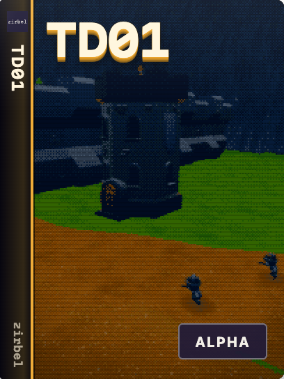

# td01



**Status:** Alpha

A village defence game: gather resources, build a tower kit, ship it and defend.
The first attack waits for your first deployed tower.

## Run

Use Node.js 24 or newer and npm.

```sh
npm ci --ignore-scripts
npm run dev                # http://localhost:5173
npm run lan                # trusted LAN: http://<host>:7777
```

WASD moves; mouse drag looks; wheel zooms; F interacts. The in-game guide can be skipped or reopened.

## Develop

```sh
npm run verify             # formatting, types, boundaries, tests, build and LAN
npm run format             # format maintained files
npm run test:browser       # first-tower playthrough; running dev server and Chrome
```

Set `CHROME_PATH` when Chrome is outside the default location.
Read [AGENTS.md](AGENTS.md) before changing code. Research and later-era systems remain deferred.

## Docs

- [Development](docs/DEVELOPMENT.md) and [architecture](docs/ARCHITECTURE.md).
- [Gameplay](docs/GAMEPLAY.md), [security](SECURITY.md) and [contributing](CONTRIBUTING.md).
- [Public repository readiness](docs/PUBLIC_REPOSITORY.md): checks and the history blocker.
- [DungeonCrawler01](https://github.com/matapao/dungeoncrawler01): an independent solo dungeon Alpha.

## License

Code: [MIT](LICENSE). Third-party assets and recordings keep their own licenses.
[Credits](docs/CREDITS.md) and [audio sources](docs/AUDIO_SOURCES.md) identify creators, sources and restrictions.
